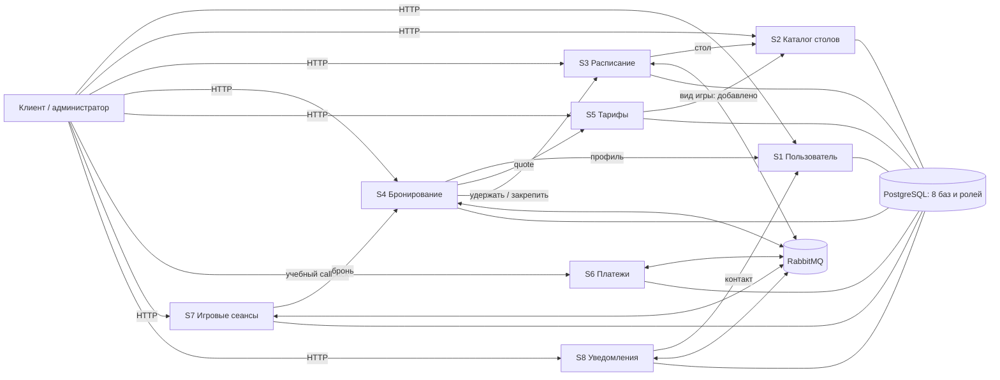

# Практическая работа 7. Реализация микросервисов

## Цель и задание

Реализовать спроектированную систему бронирования бильярда: восемь сервисов,
синхронные HTTP-вызовы и асинхронные сообщения, сохранение данных и запуск в отдельных
контейнерах. Требования методички (PDF стр. 28, печатная 50): 2–5 эндпоинтов каждого
сервиса, вызов другого сервиса из эндпоинта у каждого студента, хотя бы одна БД,
отдельный Docker-контейнер сервиса и общий Docker Compose.

## Участники и ответственность

Группа ИКБО-63-23; фамилии и инициалы взяты из отчёта практик 1–4. Сохранены четыре
пары сервисов из этого отчёта. Привязка безымянных «участников 1–4» к людям принята
по порядку фамилий на титульном листе; соответствие кратких имён фамилиям уточнено.

| Студент | Сервисы | HTTP-вызов другого сервиса |
|---|---|---|
| Данек, Черновасиленко Д. С. | S1 Пользователь, S8 Уведомления | S8 `:send` → S1 получение контакта |
| Андрей, Исаченко А. Д. | S2 Каталог столов, S5 Тарифы | S5 создание quote → S2 получение стола |
| Саша, Волентир А. Ф. | S3 Расписание, S7 Игровые сеансы | S3 график/удержание → S2; S7 `:start` → S4 |
| Анвар, Нартаджиев А. Р. | S4 Бронирование, S6 Платежи | S4 создание брони → S1, S5, S3 |

В итоговой диаграмме у пары S2/S5 не было исходящей синхронной зависимости. Добавлен
S5→S2 при расчёте цены: сервис тарифов получает вид игры у владельца карточки стола
и проверяет публикацию, вместо доверия данным клиента. Это содержательное дополнение
к диаграмме и одновременно выполнение требования для Андрея.

## Архитектура и технологии

Python, FastAPI и Pydantic отвечают за HTTP API и проверку входных данных. HTTPX
используется для синхронных вызовов с ограничением ожидания. SQLAlchemy и psycopg
сохраняют данные в PostgreSQL. RabbitMQ и Pika обеспечивают сообщения AMQP,
подтверждения доставки и маршрутизацию. Pytest используется в работе 8.



PG на схеме — один сервер, внутри которого восемь отдельных баз. Соединения к нему
не означают общей базы или чтения таблиц другого сервиса. Названия контейнеров
совпадают с именами Python-пакетов: `users`, `catalog`, `schedule`, `bookings`,
`pricing`, `payments`, `sessions`, `notifications`. RabbitMQ и PostgreSQL —
инфраструктура, а не дополнительные бизнес-микросервисы.

## Организация кода

| Путь | Назначение |
|---|---|
| `services/<name>/api.py` | HTTP-маршруты, параметры пути/query, модели тела |
| `services/<name>/models.py` | Pydantic-модели входных данных, где они нужны |
| `services/<name>/service.py` | Правила предметной области, команды, обработчики событий |
| `services/<name>/main.py` | Фабрика FastAPI-приложения и точка запуска |
| `services/<name>/Dockerfile` | Сборка отдельного контейнера |
| `common/context.py` | Внедряемые зависимости: хранилище, HTTP, часы, настройки |
| `common/store.py` | MemoryStore для изоляции тестов и SQLStore для постоянных данных |
| `common/http.py` | HTTP-адаптер, тайм-ауты и перевод ошибок в DomainError |
| `common/messaging.py` | Топология RabbitMQ, outbox/inbox, consumer, повторы и DLQ |
| `common/runtime.py` | Жизненный цикл приложения, запуск/остановка broker worker и таймеров |
| `infra/init-databases.sql` | Создание восьми баз PostgreSQL и восьми владельцев |
| `practice5/` | Самостоятельная демонстрация четырёх вариантов RabbitMQ |
| `tests/` | Проверки бизнес-логики, HTTP-компонентов и дополнительные проверки |

Общий код содержит технические адаптеры, но не общую доменную БД. Каждый сервис
изменяет только своё состояние. Через Context можно подменить внешние зависимости
и часы: бизнес-проверки не требуют ожидания десяти минут в реальном времени.

## Данные и локальные транзакции

| Сервис / база / роль | Основные разделы состояния |
|---|---|
| `users` | Клиенты, уникальные контакты |
| `catalog` | Карточки столов, уникальные номера |
| `schedule` | Рабочие окна, удержания и закреплённые интервалы |
| `bookings` | Брони, сохранённая цена, статус оплаты/возврата |
| `pricing` | Неизменяемые версии тарифов, ценовые предложения |
| `payments` | Платежи, индекс по броням, состояние возвратов |
| `sessions` | Посещения, индекс по броням, отметки отмены |
| `notifications` | Сообщения, дедупликация, попытки и отмена |

В каждой БД есть **одна таблица `service_state` с одной JSON-записью**. В документе
находятся доменные данные, `inbox` и `outbox`. Перед изменением PostgreSQL блокирует
эту строку через `SELECT ... FOR UPDATE`. Проверка, изменение и outbox фиксируются
одной локальной транзакцией. Это обеспечивает сериализацию конкурирующих команд,
включая борьбу за один интервал, ценой грубой блокировки всего сервиса.

Это явное учебное упрощение предыдущего проекта: нормализованные таблицы агрегатов,
индекс диапазонов времени и PostgreSQL exclusion constraint в этой реализации не
используются. Их роль в небольшом стенде выполняют блокировка и проверки кода.
Для большого объёма такую запись нужно заменить отдельными таблицами и блокировками
конкретного агрегата. Схема создаётся SQLAlchemy при старте; миграции Alembic не добавлены.
Внешних ключей и общих транзакций между базами нет.

## Выполнение основных сценариев

1. Администратор добавляет и публикует стол S2, задаёт его рабочее окно S3.
2. Управляющий публикует тариф S5; клиент регистрируется в S1 и получает quote.
3. S4 проверяет клиента, срок/применимость quote и получает удержание S3.
4. Бронь сохраняется как `waiting_payment`; outbox публикует `booking.payment_requested`.
5. S6 создаёт один платёж, публикует `payment.created`; S4 сохраняет данные оплаты.
6. Учебный callback S6 отмечает успех. Событие `payment.succeeded` вызывает закрепление
   удержания через HTTP S3, после чего S4 публикует `booking.confirmed`.
7. S7 создаёт ожидаемое посещение; S8 готовит сообщение и, если возможно, напоминание
   за час. Эти потребители получают отдельные копии события.
8. Администратор начинает посещение через S7 с актуальной проверкой брони; завершение
   S7 вызывает событие и закрытие S4.

Отмена снимает занятость и ожидаемое посещение. При отмене оплаченной брони не менее
чем за два часа начинается полный возврат. Если оплата приходит после отмены/истечения,
бронь не восстанавливается, запускается полный возврат независимо от двухчасового окна.
Результат возврата приходит отдельным учебным callback; запрос возврата сам по себе
не означает, что деньги возвращены.

Таймер S3 закрывает просроченные удержания. Таймер S7 фиксирует неявку через 15 минут
и завершает начатую игру по концу интервала. Таймер S8 выполняет готовые сообщения и
повторы отправки. Это фоновые процессы внутри сервисов. Раннее завершение игры и
неявка не освобождают остаток оплаченного времени автоматически.

## Доставка сообщений и отказоустойчивость

Exchange `billiards.events` — durable topic. На каждый получающий сервис выделена
durable очередь; опубликованные сообщения persistent. Queue bindings и полный
контракт сообщений перечислены в работе 5. `billiards.audit` получает копии событий
для наблюдения, с ограничением 10 000 сообщений; это не безграничный аудит.

Outbox сохраняется вместе с бизнес-изменением. Worker публикует сообщение с `mandatory`
и publisher confirms; после подтверждения удаляет соответствующую запись outbox.
Сбой между публикацией и удалением даёт повторную доставку, поэтому гарантируется
«как минимум один раз», а не exactly once. Inbox хранит идентификатор обработанного
события в одной транзакции с изменением состояния, повтор подтверждается без повторного
бизнес-действия.

Consumer использует ручной ACK и `prefetch_count=1`. Временные ошибки допускают
до трёх попыток; повтор адресуется только очереди данного потребителя, чтобы не
повторять доставку другим подписчикам. Невалидное сообщение/неустранимый доменный
конфликт отправляется сразу в DLQ; третья неудачная попытка — также в DLQ.
DLQ называется `billiards.<service>.dead`, dead-letter exchange — `billiards.dead`
типа direct. Перед ACK исходной доставки сообщение явно публикуется в DLQ с
`mandatory` и publisher confirm. Если публикация повтора/DLQ не удалась, исходная
доставка остаётся неподтверждённой и может быть получена вновь после разрыва соединения.
Настройки dead-letter у рабочей очереди также сохранены как резервный механизм.
Повторы сохраняют исходный идентификатор события.

При потере HTTP-ответа закрепления S4 не делает немедленный возврат: временная ошибка
вызывает повтор обработки, а S3 идемпотентно возвращает закреплённое удержание.
После исчерпания трёх попыток событие находится в DLQ: для продолжения требуется
разбор и повторная доставка после устранения ошибки. Автоматической бесконечной
сверки зависших процессов в этом стенде нет.

## Контейнеризация и конфигурация

Каждый сервис собирается из собственного Dockerfile и работает в отдельном процессе
Uvicorn. Compose содержит восемь приложений, PostgreSQL и RabbitMQ. На хост выведены
порты приложений 8001–8008 и RabbitMQ 5672/15672, только на `127.0.0.1`.
Контейнеры вызывают друг друга по внутренним DNS-именам, например `http://catalog:8000`.
PostgreSQL не публикуется наружу. Данные PostgreSQL и RabbitMQ хранятся в именованных томах.

```bash
cp .env.example .env
docker compose up --build -d
docker compose ps
docker compose logs -f bookings payments
```

Эти команды — инструкция запуска; фактический статус проверки контейнеров указан
в README/работе 8. `docker compose down` останавливает стенд, сохраняя тома.

| Настройка | Назначение |
|---|---|
| `DATABASE_URL` | Подключение конкретного сервиса к его БД |
| `RABBITMQ_URL` | AMQP URL; внутри Compose указывает `rabbitmq:5672` |
| `PROVIDER_TOKEN` | Токен учебных callback S6 |
| `SERVICE_HOST_TEMPLATE` | Шаблон адресов HTTP, по умолчанию `http://{service}:8000` |
| `<SERVICE>_URL` | Точное переопределение адреса, например `USERS_URL` |
| `HTTP_TIMEOUT` | Тайм-аут межсервисных HTTP-запросов, по умолчанию 5 секунд |
| `TIMER_INTERVAL` | Период фоновой проверки, по умолчанию 1 секунда |

`/health` сообщает доступность процесса и `broker_connected`. Ответ HTTP 200 сам по
себе не доказывает успешную доставку сообщений; поле брокера нужно проверять отдельно.
Swagger UI — `/docs`, схема API — `/openapi.json` каждого сервиса.

## Границы реализации и результат

Реализованы все восемь контекстов итоговой диаграммы; у семи по четыре HTTP-операции,
у расписания пять. Каждый участник имеет эндпоинт с исходящим HTTP-вызовом. Все
сервисы используют свою PostgreSQL-базу, а не только один обязательный по методичке.
Для каждого подготовлен отдельный контейнер и описание запуска Compose.

Стенд намеренно ограничен учебной предметной областью. Провайдер оплаты принимает
локальный callback и не списывает реальные деньги; провайдер сообщений записывает
демонстрационную доставку в лог. Аутентификация клиентов, роли и привязка `user_id`
к токену, описанные на уровне архитектуры в отчёте 1–4, не реализованы. Клиентские
создающие запросы не имеют общего ключа идемпотентности. Полного журнала шагов саги
и восстановления создания брони после аварии также нет: если S3 успел удержать
время, а S4 остановился до сохранения брони, удержание освободится по сроку.

Выбранное хранение JSON, единичное рабочее окно, отсутствие миграций и ограниченное
восстановление после исчерпания повторов явно отличаются от полного промышленного
варианта архитектуры. Они не скрываются под заявлением о проверенной промышленной
готовности. Результаты реально выполненных тестов и ограничения проверки Docker
приведены в работе 8.
